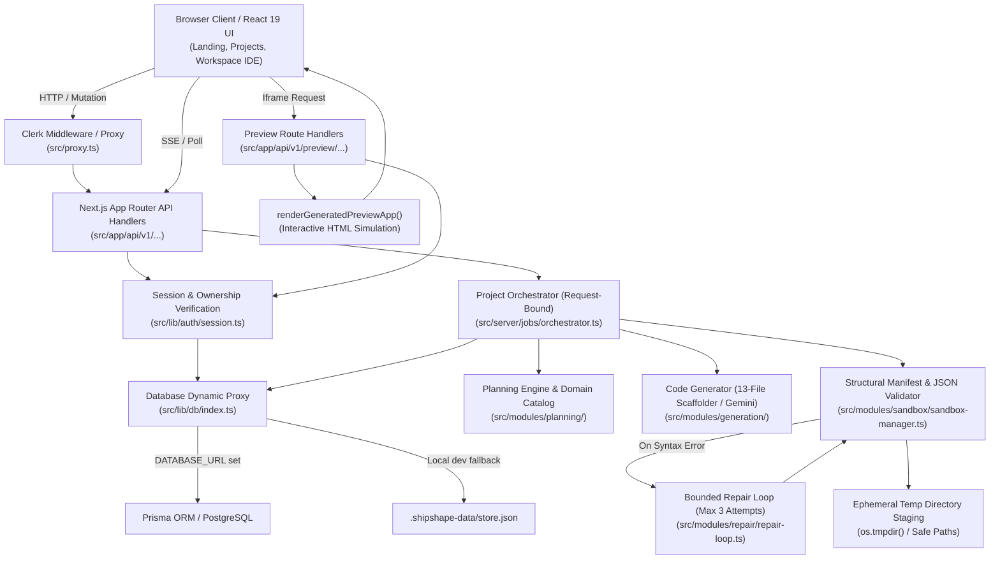
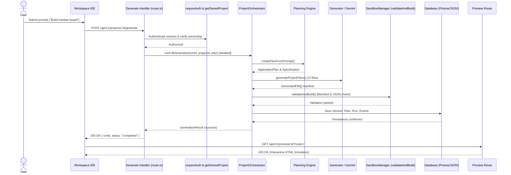

# Shipshape — System Architecture & Technical Reference

**Document status:** Phase 2 Technical Reference — Implementation-Grounded & Source-Verified<br/>
**Baseline Git commit:** `56549e734463e11d35789558c023546420d70a62` (`56549e7`), branch `main`<br/>
**Working tree status:** Tracked files: Clean at `56549e7`. Untracked local files: `SHIPSHAPE_DOCUMENTATION_GAP_ANALYSIS.md`.<br/>
**Audited runtime environment:** macOS Darwin 24.6.0 arm64, Node.js `v26.12.1`, npm `11.6.0`, Vitest `v5.0.5`, Next.js `16.4.3`, Prisma `7.10.1`<br/>
**Documentation review date:** 30 October 2026<br/>
**Scope:** Verified codebase reality at commit `56549e7`; planned architecture and interface stubs are explicitly labeled.

---

## Table of Contents

1. [Purpose, Scope, and Capability Status](#1-purpose-scope-and-capability-status)
2. [Current System Summary](#2-current-system-summary)
3. [Architecture and Execution Boundaries](#3-architecture-and-execution-boundaries)
4. [Technology Stack and Runtime Requirements](#4-technology-stack-and-runtime-requirements)
5. [Repository Map](#5-repository-map)
6. [Frontend Architecture](#6-frontend-architecture)
7. [HTTP API Inventory](#7-http-api-inventory)
8. [Authentication and Authorization](#8-authentication-and-authorization)
9. [Planning and Specification](#9-planning-and-specification)
10. [Code Generation](#10-code-generation)
11. [AI Provider Integration](#11-ai-provider-integration)
12. [Generation Orchestration and Lifecycle](#12-generation-orchestration-and-lifecycle)
13. [Sandbox Staging and Preview Behavior](#13-sandbox-staging-and-preview-behavior)
14. [Validation and Repair](#14-validation-and-repair)
15. [Versioning, Diff, Restore, and Export](#15-versioning-diff-restore-and-export)
16. [Persistence Architecture](#16-persistence-architecture)
17. [Database Model Inventory](#17-database-model-inventory)
18. [Data Flows](#18-data-flows)
19. [SSE, Polling, and Cancellation](#19-sse-polling-and-cancellation)
20. [Security and Privacy Boundaries](#20-security-and-privacy-boundaries)
21. [Configuration and Integrations](#21-configuration-and-integrations)
22. [Development, Testing, and Deployment](#22-development-testing-and-deployment)
23. [Known Limitations and Roadmap](#23-known-limitations-and-roadmap)
24. [Documentation Verification and Sign-off](#24-documentation-verification-and-sign-off)
25. [Glossary and Change History](#25-glossary-and-change-history)

---

## 1. Purpose, Scope, and Capability Status

### 1.1 Purpose
**Shipshape** is a web application that accepts natural-language software prompts, produces a structured project specification, generates a coherent multi-file project scaffold, stores versioned project artifacts, and presents an interactive in-browser preview simulation of the synthesized application.

The active codebase is an **AI-assisted project scaffold generator with an interactive HTML preview simulation**, rather than an arbitrary-code execution platform. Specifically, the preview route renders synthesized markup and client-side behavior via `renderGeneratedPreviewApp()`. It does **not** compile, bundle, or run the generated Next.js project inside a live container or virtual machine.

### 1.2 Scope of this Document
This technical reference documents the implementation at Git commit `56549e7`. It provides:
- The Next.js 16 App Router application routes and workspace IDE panels.
- The 21 route files exposing 27 distinct HTTP method operations under `/api/v1/`.
- Clerk identity integration and project ownership authorization.
- Prompt interpretation and deterministic domain taxonomy matching.
- Multi-file scaffold synthesis (13 deterministic files) and Google Gemini integration.
- Request-bound orchestration within Next.js API handlers.
- Local temporary-directory file staging and safe-path enforcement.
- In-browser interactive preview simulation and same-origin rendering.
- Structural manifest validation, JSON syntax verification, and bounded repair heuristics.
- Version lineages, unified diff calculation, version restoration, and ZIP export with secret scrubbing.
- Dual-adapter persistence (Prisma PostgreSQL and local JSON store).
- Test execution baseline (72 passing tests across 12 test files).

Architectural components, cloud providers, and container isolation boundaries are only described as active when substantiated by running code and tests.

### 1.3 Capability Status Taxonomy
Every feature and subsystem in this document is labeled using the following five-tier taxonomy:

| Status | Definition | Acceptance Requirement |
|---|---|---|
| **Implemented and verified** | Code exists, and automated tests or verified runtime commands prove the stated behavior. | Source symbol + test identifier / repeatable command. |
| **Implemented** | Code exists, but complete operational or end-to-end deployment verification is unavailable. | Source symbol + explicit operational caveats. |
| **Partially implemented** | Some code or interface scaffolding exists, but functional execution is incomplete. | Concrete boundary documented + missing components listed. |
| **Planned** | Architectural design or provider interface exists, but no operational driver is wired. | Labeled as roadmap/future work; not described as active. |
| **Not implemented** | Capability is completely absent from the codebase. | Explicitly recorded where material. |

### 1.4 Capability Summary Matrix

| Capability | Status at Commit `56549e7` | Implementation Reality & Boundaries |
|---|---|---|
| **Project CRUD & Duplication** | Implemented and verified | Full project lifecycle (create, read, patch, duplicate, soft-delete) implemented via `src/app/api/v1/projects/`. |
| **Natural-Language Planning** | Implemented and verified | Domain taxonomy engine in `src/modules/planning/` maps prompts to structured `ProjectSpecification` records. |
| **Scaffold Code Generation** | Implemented and verified | `src/modules/generation/generator.ts` deterministically outputs **exactly 13 scaffold files**. |
| **Gemini AI Generation** | Implemented and verified | `src/modules/ai/gemini-provider.ts` calls Google Gemini REST API with schema validation and deterministic fallback. |
| **Local Temporary File Staging** | Implemented and verified | `SandboxManager.prepareWorkspace()` writes files to `os.tmpdir()` with strict path traversal containment checks. |
| **Interactive In-Browser Preview** | Implemented (HTML Simulation) | `src/app/api/v1/preview/` returns interactive HTML with mock data and local storage via `renderGeneratedPreviewApp()`. |
| **Static Manifest & JSON Validation** | Implemented and verified | `validateAndBuild()` verifies file presence and parses JSON files. It does **not** invoke compilers or bundlers. |
| **Bounded Repair Loop** | Implemented and verified | `BoundedRepairLoop` applies targeted syntax and missing-file repairs with a maximum of 3 attempts. |
| **Version History & Diff** | Implemented and verified | Version snapshots, unified diffs via `diff`, and non-destructive rollbacks implemented in `src/modules/versioning/`. |
| **ZIP Export & Scrubbing** | Implemented and verified | JSZip packaging with regex secret scrubbing in `src/modules/export/`. `X-Export-Files-Count` is dynamically set. |
| **Dual-Adapter Persistence** | Implemented and verified | `src/lib/db/index.ts` selects Prisma PostgreSQL if `DATABASE_URL` is set; defaults to JSON in dev; throws in prod. |
| **Durable Worker Queue** | Not implemented | Generation is synchronous and awaited directly inside the HTTP request handler (`maxDuration = 60`). |
| **Child-Process Compilation & Startup** | Implemented in Docker Sandbox; pending generation orchestrator integration | `DockerSandboxProvider` executes `next build` and manages long-running `next start` server processes in isolated containers; platform HTTP API currently defaults to simulation. |
| **Sandbox Execution Engine** | Implemented (`local_temp` & `docker`) | `SandboxProvider` interface implemented by `LocalTempSandboxProvider` and `DockerSandboxProvider` (`Dockerfile.sandbox`), enforcing resource limits, capability drops, and loopback binding. |
| **Headless Browser Verification** | Implemented and verified | `PlaywrightRunner`, `VisualViewportChecker`, `ConsoleErrorCollector`, and `FunctionalVerificationService` in `src/modules/verification/` testing responsive design, overflow, state persistence across reloads, and zero console errors. |

---

## 2. Current System Summary

### 2.1 Request-to-Preview Flow
The end-to-end workflow at commit `56549e7` proceeds as follows:
1. **Prompt Submission**: The user submits an application prompt through the workspace UI.
2. **Authentication & Ownership**: Next.js App Router API handlers authenticate the caller via Clerk and verify project ownership.
3. **Synchronous Orchestration**: The handler invokes `ProjectOrchestrator.runFullGeneration()` and awaits completion within the HTTP request.
4. **Specification & Planning**: `createPlanFromPrompt()` evaluates domain keywords and produces an `ApplicationPlan` and `ProjectSpecification`.
5. **Code Synthesis**: The generator synthesizes 13 deterministic scaffold files (or invokes Gemini API if configured).
6. **Structural Validation**: `SandboxManager.validateAndBuild()` checks manifest completeness and parses JSON syntax.
7. **Ephemeral Staging**: Files are written to an OS temporary directory (`os.tmpdir()`) with path traversal guards.
8. **Durable Publication**: Run metadata, events, version records, and file contents are written to the active database adapter.
9. **Interactive Preview**: The browser loads `GET /api/v1/preview/:projectId/`, which dynamically returns an interactive HTML simulation.

### 2.2 Explicit Architectural Boundaries (Non-Claims)
The current Shipshape implementation does **not** provide:
- Execution of arbitrary generated code in isolated Docker containers, VMs, or microVMs.
- Sandboxed execution of generated Node.js server runtimes.
- Asynchronous durable queue processing (e.g., Celery, BullMQ, Inngest).
- Live execution of `npm install`, TypeScript compiler (`tsc`), or production bundling (`next build`) on generated code.
- Deployed production relational databases or serverless backends for generated applications.
- Absolute secret scrubbing (regex detection is heuristic defense-in-depth).

---

## 3. Architecture and Execution Boundaries

### 3.1 Logical Architecture



### 3.2 Components and Responsibilities

| Subsystem | Source Location | Responsibility | Execution Boundary |
|---|---|---|---|
| **Frontend IDE** | `src/app/`, `src/components/` | Workspace layout, code inspector, diff viewer, chat input, preview iframe. | Client-side React 19 execution in user's browser. |
| **Auth Middleware** | `src/proxy.ts` | Clerk session validation and route matching. | Edge/Node runtime; does not replace route-level authorization. |
| **API Handlers** | `src/app/api/v1/**/route.ts` | Input parsing, resource authorization, service invocation, HTTP responses. | Next.js server runtime; synchronously awaited. |
| **Session Helpers** | `src/lib/auth/session.ts` | Resolves Clerk user, provisions local user record, validates project ownership. | Scoped to database lookup of `ownerUserId`. |
| **Orchestrator** | `src/server/jobs/orchestrator.ts` | Coordinates planning, synthesis, validation, repair, staging, and publication. | In-process execution within the active HTTP request. |
| **Planning Engine** | `src/modules/planning/` | Matches prompt keywords to domain catalog, outputs `ProjectSpecification`. | Synchronous deterministic rule execution. |
| **Generator** | `src/modules/generation/generator.ts` | Synthesizes 13 Next.js project files with typed seed data and local storage. | In-memory string synthesis. |
| **Gemini Provider** | `src/modules/ai/gemini-provider.ts` | Calls Google Gemini REST API with JSON Schema enforcement; handles fallbacks. | External HTTPS REST call to Google API. |
| **Sandbox Manager** | `src/modules/sandbox/sandbox-manager.ts` | Manifest checking, JSON parsing, and temporary filesystem writes. | Local filesystem I/O in `os.tmpdir()`. |
| **Repair Loop** | `src/modules/repair/repair-loop.ts` | Fixes broken JSON formatting, missing commas, and missing manifest entries. | Bounded loop (up to 3 iterations) in memory. |
| **Versioning Engine**| `src/modules/versioning/diff-engine.ts` | Calculates unified diffs between snapshots; executes non-destructive rollback. | In-memory diffing via `diff` library. |
| **Export Service** | `src/modules/export/export-service.ts` | Packages project files into a `.zip` archive; applies regex secret scrubbing. | In-memory JSZip buffer generation. |
| **Database Proxy** | `src/lib/db/index.ts` | Routes repository calls to Prisma PostgreSQL or local JSON store. | Local JSON I/O or pooled PostgreSQL connection. |

### 3.3 Request-Bound Execution Constraints & Disconnect Semantics
Generation is executed synchronously inside `POST /api/v1/projects/:projectId/generate`:
- **Execution Deadline**: Bounded by `export const maxDuration = 60;` (Vercel serverless request timeout).
- **Client Disconnect vs. Cancellation Invariant**: Browser disconnection (such as a page refresh or temporary network blip) does **not** abort or cancel active generation. `req.signal` is deliberately not hooked to run destruction to protect expensive in-flight runs. The client can cleanly reconnect to in-progress runs via `GET /api/v1/generation-runs/:runId` and `GET /api/v1/generation-runs/:runId/events`.
- **Explicit Cancellation**: Active generation is aborted only upon an explicit user action triggering `POST /api/v1/generation-runs/:runId/cancel`. This signals the orchestrator's `AbortController` to terminate in-flight AI provider HTTP calls and permanently halts pipeline transitions prior to version publication.
- **Worker Recovery**: No background worker queue exists. If the server process crashes or restarts during generation, the active run remains in a non-terminal state until reaped by stale-run detection (`>120s`).

---

## 4. Technology Stack and Runtime Requirements

### 4.1 Dependency Stack

| Layer | Package | Locked / Specified Version | Engineering Purpose |
|---|---|---|---|
| **Web Framework** | `next` | `16.4.3` | App Router, Turbopack, Server Functions, route handlers. |
| **UI Library** | `react`, `react-dom` | `19.3.0` | React 19 Client and Server Components. |
| **Language** | `typescript` | `^5` | Strict static typechecking (`strict: true`). |
| **Styling** | `tailwindcss`, `@tailwindcss/turbopack` | `^4` | Utility-first styling via Tailwind CSS v4. |
| **Authentication** | `@clerk/nextjs` | `^7.9.21` | Authentication and user session tokens. |
| **ORM** | `@prisma/client`, `prisma` | `^7.10.1` | Type-safe PostgreSQL data access and migrations. |
| **Database Driver**| `pg`, `@prisma/adapter-pg` | `^8.23.1` / `^7.10.1` | PostgreSQL connection pool driver. |
| **Validation** | `zod` | `^4.6.7` | Request schema validation and data sanitization. |
| **Compression** | `jszip` | `^3.10.2` | In-memory ZIP archive generation for export. |
| **Diffing** | `diff` | `^9.0.0` | Computing unified structural diffs between versions. |
| **Icons** | `lucide-react` | `^1.61.0` | Workspace IDE icons. |
| **Testing** | `vitest` | `^5.0.5` | Fast unit and integration test runner. |
| **AI Integration** | REST API (`fetch`) | `v1beta` | Direct HTTPS communication with Google Gemini API. |

### 4.2 Node.js Engine & LTS Policy
The repository specifies Node.js **24 Active LTS** across all runtime and deployment layers:
- **`package.json`**: Explicitly pins `"engines": { "node": "^24.0.0" }`.
- **`.nvmrc`**: Standardized to `24`.
- **CI / GitHub Actions**: Workflow `.github/workflows/ci.yml` builds and tests strictly on `node-version: 24`.
- **LTS & Compatibility Context**:
  - **Node.js 20**: Reached End-of-Life on April 30, 2026.
  - **Next.js 16.4.3**: Enforces a minimum runtime of Node.js `>=20.9.0`.
  - **Prisma ORM 7.10.1**: System requirements officially mandate Node.js `^20.19.0 || ^22.12.0 || ^24.0.0`. Node 24 is Active LTS through April 2028. Node 26 LTS (released late October 2026) is undergoing validation before inclusion in Prisma's published matrix.

The configured runtime specification is:
```json
{
  "engines": {
    "node": "^24.0.0"
  }
}
```

---

## 5. Repository Map

The repository structure at commit `56549e7`:

```
Shipshape/
├── .agents/                          # Local agent skills and workflows
├── .env.example                      # Template for environment variables
├── AGENTS.md                         # Framework agent rules (Next.js 16 guardrails)
├── package.json                      # Dependency manifests and scripts
├── package-lock.json                 # Pinned dependency lockfile
├── next.config.ts                    # Next.js configuration (Turbopack, cacheComponents)
├── eslint.config.mjs                 # Flat ESLint configuration
├── prisma.config.ts                  # Prisma configuration
├── vitest.config.mts                 # Vitest test runner configuration
├── tsconfig.json                     # Strict TypeScript compiler options
├── prisma/
│   ├── schema.prisma                 # 16-model PostgreSQL schema
│   ├── migrations/                   # Applied SQL migration history
│   │   ├── 20261028083000_init/
│   │   └── 20261028110000_nullable_plan_json/
│   └── schema.sql                    # Raw SQL DDL reference
├── scripts/
│   ├── audit-json-migration.mjs      # Validates JSON store records against Postgres
│   └── import-json-to-neon.mjs       # Migrates local JSON records to PostgreSQL
├── src/
│   ├── proxy.ts                      # Clerk middleware entry point
│   ├── app/                          # Next.js App Router pages and API routes
│   │   ├── page.tsx                  # Public landing page
│   │   ├── projects/page.tsx         # Project management dashboard
│   │   ├── applications/page.tsx     # Conversational assistant
│   │   ├── workspace/[projectId]/    # Main builder workspace IDE
│   │   ├── sign-in/ & sign-up/       # Clerk auth pages
│   │   └── api/v1/                   # 21 route files (27 method operations)
│   ├── components/                   # React 19 UI components
│   │   ├── landing/                  # Landing page presentation components
│   │   └── workspace/                # Workspace IDE panels (Header, Code, Diff, Preview)
│   ├── lib/
│   │   ├── auth/session.ts           # Clerk session verification and ownership
│   │   ├── db/                       # Prisma adapter, JSON adapter, dynamic proxy
│   │   └── project-utils.ts          # Title formatting and string sanitization
│   ├── modules/
│   │   ├── planning/                 # Domain catalog taxonomy and planning engine
│   │   ├── generation/               # Deterministic 13-file scaffold synthesizer
│   │   ├── ai/                       # Google Gemini API client and fallback logic
│   │   ├── sandbox/                  # Local temp staging and provider interface
│   │   ├── repair/                   # Bounded JSON/syntax repair loop
│   │   ├── versioning/               # Diff engine and version restore
│   │   └── export/                   # JSZip archive creation and secret scrubbing
│   ├── server/
│   │   ├── jobs/orchestrator.ts      # Generation workflow execution coordinator
│   │   └── security/                 # Safe-path containment and secret scrubber
│   └── types/index.ts                # TypeScript interfaces and Zod validation schemas
└── tests/
    ├── unit/                         # 10 unit test suites (Vitest)
    └── integration/                  # 2 integration test suites
```

### 5.1 Local Runtime Artifacts (Git-Ignored)
The following directories and files are local runtime state and must never be committed to source control (verified in `.gitignore` lines 34, 45, 46):
- `.env.local`: Local developer environment variables and secret keys.
- `.sandboxes/`: Ephemeral filesystem directories written during local staging.
- `.shipshape-data/`: Local JSON datastore (`store.json`) used when `DATABASE_URL` is unset.

---

## 6. Frontend Architecture

### 6.1 Application Routes

| Path | Source File | Rendering Mode | Purpose |
|---|---|---|---|
| `/` | `src/app/page.tsx` | Static (`○`) | Marketing landing page and prompt submission entry point. |
| `/projects` | `src/app/projects/page.tsx` | Static (`○`) | Project listing, search, status overview, and project creation. |
| `/applications` | `src/app/applications/page.tsx` | Static (`○`) | Full-screen conversational requirement gathering assistant. |
| `/workspace/[projectId]` | `src/app/workspace/[projectId]/page.tsx` | Partial Prerender (`◐`) | Multi-panel workspace IDE with live preview, code tree, and chat. |
| `/sign-in/[[...sign-in]]` | `src/app/sign-in/[[...sign-in]]/page.tsx` | Partial Prerender (`◐`) | Embedded Clerk authentication sign-in component. |
| `/sign-up/[[...sign-up]]` | `src/app/sign-up/[[...sign-up]]/page.tsx` | Partial Prerender (`◐`) | Embedded Clerk authentication registration component. |

### 6.2 Main Workspace IDE Panels

| Panel Component | Source File | Subsystem Responsibility |
|---|---|---|
| **`WorkspaceHeader`** | `src/components/workspace/WorkspaceHeader.tsx` | Displays project title, version dropdown, export ZIP trigger, and runtime status pill. |
| **`ChatIterationPanel`**| `src/components/workspace/ChatIterationPanel.tsx` | Natural-language modification input, generation step progress, and error display. |
| **`PlanSpecPanel`** | `src/components/workspace/PlanSpecPanel.tsx` | Interactive view of routes, features, data entities, and design system tokens. |
| **`LivePreviewPanel`** | `src/components/workspace/LivePreviewPanel.tsx` | Iframe hosting the preview simulation; includes viewport width selectors. |
| **`CodeInspectorPanel`**| `src/components/workspace/CodeInspectorPanel.tsx` | File-tree explorer, syntax-highlighted code editor, and file size metrics. |
| **`VersionDiffPanel`** | `src/components/workspace/VersionDiffPanel.tsx` | Line-by-line unified diff viewer comparing active version against parent. |
| **`DiagnosticsPanel`** | `src/components/workspace/DiagnosticsPanel.tsx` | Manifest checks, JSON syntax validation results, and terminal build logs. |

### 6.3 Client State & Synchronization
- **Primary State**: Component-level React hooks (`useState`, `useRef`, `useMemo`).
- **Telemetry Stream**: `EventSource` connects to `GET /api/v1/generation-runs/:runId/events` to stream step progress (`step_started`, `file_generated`, `step_completed`).
- **Polling Fallback**: If SSE disconnects or errors, the client polls `GET /api/v1/generation-runs/:runId` every 1,500ms.
- **Client Watchdog**: A 60-second client watchdog unlocks the UI if the connection drops without emitting a terminal status event.

---

## 7. HTTP API Inventory

### 7.1 Counting Methodology
Shipshape provides **21 route files (`route.ts`) exposing 27 distinct HTTP method operations** under `/api/v1/`.

### 7.2 Exhaustive Method & Route Matrix

| # | HTTP Method | Route URL Pattern | Handler Source File | Zod Request Schema | Success Status | Documented Operation Purpose |
|---|---|---|---|---|---|---|
| 1 | `GET` | `/api/v1/projects` | `src/app/api/v1/projects/route.ts` | None | `200 OK` | List caller's active (non-archived) projects. |
| 2 | `POST` | `/api/v1/projects` | `src/app/api/v1/projects/route.ts` | `CreateProjectSchema` | `201 Created` | Create a new project container. |
| 3 | `GET` | `/api/v1/projects/:projectId` | `src/app/api/v1/projects/[projectId]/route.ts` | None | `200 OK` | Fetch project details by ID. |
| 4 | `PATCH` | `/api/v1/projects/:projectId` | `src/app/api/v1/projects/[projectId]/route.ts` | `UpdateProjectSchema` | `200 OK` | Update project name, description, or status. |
| 5 | `DELETE` | `/api/v1/projects/:projectId` | `src/app/api/v1/projects/[projectId]/route.ts` | None | `200 OK` | Soft-archive project (`archivedAt = now()`). |
| 6 | `POST` | `/api/v1/projects/:projectId/duplicate` | `src/app/api/v1/projects/[projectId]/duplicate/route.ts` | None | `201 Created` | Clone project, active specification, version, and files. |
| 7 | `GET` | `/api/v1/projects/:projectId/specification` | `src/app/api/v1/projects/[projectId]/specification/route.ts` | None | `200 OK` | Retrieve current `ProjectSpecification`. |
| 8 | `PATCH` | `/api/v1/projects/:projectId/specification` | `src/app/api/v1/projects/[projectId]/specification/route.ts` | `ProjectSpecification` partial | `200 OK` | Update structured specification JSON. |
| 9 | `POST` | `/api/v1/projects/:projectId/plan` | `src/app/api/v1/projects/[projectId]/plan/route.ts` | `PlanRequestSchema` | `200 OK` | Generate plan from prompt via `createPlanFromPrompt()`. |
| 10 | `GET` | `/api/v1/projects/:projectId/plan` | `src/app/api/v1/projects/[projectId]/plan/route.ts` | None | `200 OK` | Read latest parsed `ApplicationPlan`. |
| 11 | `POST` | `/api/v1/projects/:projectId/generate` | `src/app/api/v1/projects/[projectId]/generate/route.ts` | `GenerateRequestSchema` | `200 OK` | Execute synchronous project generation. |
| 12 | `POST` | `/api/v1/projects/:projectId/modify` | `src/app/api/v1/projects/[projectId]/modify/route.ts` | `ModifyRequestSchema` | `200 OK` | Apply targeted natural-language modification. |
| 13 | `GET` | `/api/v1/projects/:projectId/files` | `src/app/api/v1/projects/[projectId]/files/route.ts` | Query: `path`, `versionId` | `200 OK` | Return file manifest or specific file content. |
| 14 | `GET` | `/api/v1/projects/:projectId/export` | `src/app/api/v1/projects/[projectId]/export/route.ts` | Query: `versionId` | `200 OK` | Download `.zip` archive (`application/zip`). |
| 15 | `POST` | `/api/v1/projects/:projectId/export` | `src/app/api/v1/projects/[projectId]/export/route.ts` | None | `200 OK` | Generate export package and return metadata. |
| 16 | `POST` | `/api/v1/projects/:projectId/restore` | `src/app/api/v1/projects/[projectId]/restore/route.ts` | `RestoreVersionSchema` | `200 OK` | Restore past version by publishing a new active version. |
| 17 | `GET` | `/api/v1/projects/:projectId/versions` | `src/app/api/v1/projects/[projectId]/versions/route.ts` | None | `200 OK` | List all historical versions for project. |
| 18 | `GET` | `/api/v1/projects/:projectId/versions/:versionId` | `src/app/api/v1/projects/[projectId]/versions/[versionId]/route.ts` | None | `200 OK` | Get specific version metadata and files. |
| 19 | `GET` | `/api/v1/projects/:projectId/versions/:versionId/diff` | `src/app/api/v1/projects/[projectId]/versions/[versionId]/diff/route.ts` | None | `200 OK` | Compute unified patch diff against parent version. |
| 20 | `POST` | `/api/v1/projects/:projectId/runtime/start` | `src/app/api/v1/projects/[projectId]/runtime/start/route.ts` | None | `200 OK` | Create/activate local `SandboxSession` record. |
| 21 | `POST` | `/api/v1/projects/:projectId/runtime/stop` | `src/app/api/v1/projects/[projectId]/runtime/stop/route.ts` | None | `200 OK` | Transition `SandboxSession` to `stopped`. |
| 22 | `GET` | `/api/v1/projects/:projectId/runtime/status` | `src/app/api/v1/projects/[projectId]/runtime/status/route.ts` | None | `200 OK` | Read latest sandbox session state and mock port. |
| 23 | `GET` | `/api/v1/projects/:projectId/runtime/logs` | `src/app/api/v1/projects/[projectId]/runtime/logs/route.ts` | None | `200 OK` | Read execution and build check logs. |
| 24 | `GET` | `/api/v1/generation-runs/:runId` | `src/app/api/v1/generation-runs/[runId]/route.ts` | None | `200 OK` | Get run progress, diagnostics, and build results. |
| 25 | `POST` | `/api/v1/generation-runs/:runId/cancel` | `src/app/api/v1/generation-runs/[runId]/cancel/route.ts` | None | `200 OK` | Request cooperative cancellation of run. |
| 26 | `GET` | `/api/v1/generation-runs/:runId/events` | `src/app/api/v1/generation-runs/[runId]/events/route.ts` | None | `200 OK` (SSE) | Stream generation progress via Server-Sent Events. |
| 27 | `GET` | `/api/v1/preview/:projectId/[[...path]]` | `src/app/api/v1/preview/[projectId]/[[...path]]/route.ts` | Query: `versionId` | `200 OK` (HTML) | Serve interactive preview simulation HTML. |

---

## 8. Authentication and Authorization

### 8.1 Identity Integration
Shipshape uses **Clerk** (`@clerk/nextjs`) for user authentication:
- **Middleware**: `src/proxy.ts` wraps requests to enforce authentication on protected application routes.
- **Session Helper**: `requireAuth()` in `src/lib/auth/session.ts` extracts the Clerk user ID, retrieves or provisions a local `User` record, and returns the typed `User` entity.
- **Just-In-Time Provisioning**: If a user exists in Clerk but not in the local database, `requireAuth()` auto-creates a record in the `users` table using their primary email address and name.

### 8.2 Tenant-Scoped Authorization Matrix

Every route handler enforces tenant isolation by resolving the caller's identity and scoping database queries:

| Route Group | Authentication Check | Project Ownership Guard | Secondary Resource Validation | Implementation Status |
|---|---|---|---|---|
| **Projects Collection** (`/projects`) | `requireAuth()` | Queries scoped to `ownerUserId = user.id` | None | Implemented and verified |
| **Project Details & Mutation** (`/projects/:id`) | `requireAuth()` | `getOwnedProject(projectId, user.id)` | Returns 404 if not owned | Implemented and verified |
| **Specification & Plan** (`/projects/:id/plan`) | `requireAuth()` | `getOwnedProject(projectId, user.id)` | Enforced through parent project ownership | Implemented and verified |
| **Generation & Modification** (`/generate`, `/modify`) | `requireAuth()` | `getOwnedProject(projectId, user.id)` | Validates `baseVersionId` belongs to project | Implemented and verified |
| **File Access & Diffs** (`/files`, `/versions/...`) | `requireAuth()` | `getOwnedProject(projectId, user.id)` | Path containment check via `validateSafePath` | Implemented and verified |
| **Export Service** (`/export`) | `requireAuth()` | `getOwnedProject(projectId, user.id)` | Filters files strictly belonging to project | Implemented and verified |
| **Runtime Controls** (`/runtime/...`) | `requireAuth()` | `getOwnedProject(projectId, user.id)` | Scoped to project's active `SandboxSession` | Implemented and verified |
| **Generation Runs** (`/generation-runs/:runId`) | `requireAuth()` | Resolves run -> checks project ownership | Blocks cross-tenant read of run events/logs | Implemented and verified |
| **Preview Simulation** (`/preview/:id/...`) | `requireAuth()` | `getOwnedProject(projectId, user.id)` | Renders 404/401 HTML error page on mismatch | Implemented and verified |

---

## 9. Planning and Specification

### 9.1 Entry Points and Domain Taxonomy
Prompt interpretation is handled by `src/modules/planning/planning-engine.ts` using `inferDomain()` from `src/modules/planning/domain-catalog.ts`.

The taxonomy evaluates prompt keywords against eight curated domains:

| Domain ID | Matching Keyword Triggers | Primary Entity Synthesized | Default Accent Color |
|---|---|---|---|
| **`todo`** | `todo`, `to-do`, `checklist`, `task list`, `reminders`, `habit` | `TodoItem` (title, category, priority, status) | Emerald (`#10b981`) |
| **`kanban`** | `kanban`, `board`, `sprint`, `backlog`, `column`, `scrum` | `KanbanCard` (title, column, priority, storyPoints) | Indigo (`#6366f1`) |
| **`ecommerce`** | `shop`, `ecommerce`, `store`, `cart`, `product`, `checkout` | `ProductItem` (name, price, stock, rating, category) | Amber (`#f59e0b`) |
| **`finance`** | `finance`, `budget`, `expense`, `transaction`, `crypto`, `wallet` | `Transaction` (payee, amount, type, category, date) | Violet (`#8b5cf6`) |
| **`crm`** | `crm`, `lead`, `deal`, `contact`, `customer`, `pipeline`, `sales` | `Deal` (contact, value, stage, probability) | Sky (`#0284c7`) |
| **`notes`** | `note`, `notebook`, `memo`, `journal`, `document`, `wiki` | `NoteItem` (title, content, tags, folder, isPinned) | Yellow (`#eab308`) |
| **`fitness`** | `fitness`, `workout`, `exercise`, `gym`, `diet`, `calorie` | `WorkoutItem` (exercise, sets, reps, durationMinutes) | Rose (`#f43f5e`) |
| **`general`** | *Default fallback if no domain triggers match* | `CustomItem` (title, description, status, tags) | Blue (`#3b82f6`) |

---

## 10. Code Generation

### 10.1 Deterministic Generator
The deterministic generator in `src/modules/generation/generator.ts` synthesizes **exactly 13 scaffold files** without requiring external AI APIs:

```
Generated Scaffold Structure (13 Files):
├── package.json                   # Dependencies: Next.js 16, React 18/19, Lucide, Tailwind
├── tsconfig.json                  # Strict TypeScript compiler options
├── tailwind.config.js             # Tailwind token configuration
├── src/
│   ├── lib/
│   │   └── storage.ts             # Reactive browser storage & CSV export utilities
│   ├── components/
│   │   ├── HeaderNav.tsx          # Top navigation bar with live status indicators
│   │   └── ItemModal.tsx          # CRUD dialog for adding/editing records
│   └── app/
│       ├── globals.css            # Tailwind styling tokens and CSS variables
│       ├── layout.tsx             # Root layout with metadata and styling
│       ├── page.tsx               # Overview dashboard with live calculated KPI cards
│       ├── explore/page.tsx       # Interactive CRUD data table with search, filter, CSV
│       ├── analytics/page.tsx     # Visual metrics and distribution breakdown charts
│       ├── settings/page.tsx      # Reset demo data, theme preferences, export settings
│       └── api/health/route.ts    # JSON health diagnostic endpoint
```

> [!NOTE]
> The original documentation erroneously enumerated 20 files, including non-existent files (`postcss.config.js`, `next.config.mjs`, `README.md`, `DataManagementTable.tsx`, `DashboardView.tsx`, `src/lib/csv-export.ts`, `src/app/api/items/route.ts`). Code inspection of `generateProjectFiles()` confirms exactly 13 files are pushed to the file manifest.

### 10.2 Scaffold Capability Boundary
Generated applications run entirely on **client-side state and reactive browser storage** (`src/lib/storage.ts` using `localStorage` and custom DOM event dispatching). They are interactive prototypes, not deployed production backends.

---

## 11. AI Provider Integration

### 11.1 Gemini Configuration
AI generation is implemented in `src/modules/ai/gemini-provider.ts`:
- **Model Resolution**:
  ```ts
  export const PRIMARY_MODEL = process.env.GEMINI_MODEL || 'gemini-3.6-flash';
  export const FALLBACK_MODEL = process.env.GEMINI_FALLBACK_MODEL || 'gemini-3.8-flash';
  const REQUEST_TIMEOUT_MS = process.env.GEMINI_TIMEOUT_MS ? parseInt(process.env.GEMINI_TIMEOUT_MS, 10) : 55000;
  ```
- **Lifecycle & Routing**: `gemini-3.5-flash` was deprecated by Google and requests auto-route to `3.6 Flash`. Phase 3 established `gemini-3.6-flash` as the production primary model identifier.
- **Thinking Configuration**: Requests configure `thinkingConfig: { thinkingBudget: 0 }` to avoid ~9,600 auxiliary thought tokens and eliminate 45-60s latency bottlenecks on multi-file synthesis.
- **In-Flight Cancellation**: `callGeminiApi`, `generateProject`, and `modifyProject` accept an `AbortSignal`. When a user cancels, the underlying `fetch` request is terminated immediately via `AbortController`, preventing both wasted token costs and silent fallback to deterministic generation.
- **Automatic Deterministic Fallback**: If Gemini encounters rate limits (`429`), auth errors (`401/403`), model errors (`404`), or inference errors (and the run was **not** user-cancelled), it automatically falls back to `generateProjectFiles()` without failing the generation run.

### 11.2 Empirical Model Benchmarking & Report
A repeatable evaluation harness is provided via `npm run benchmark:gemini` (`scripts/benchmark-gemini.mjs`), with results persisted in `SHIPSHAPE_GEMINI_BENCHMARK_REPORT.md`.

The benchmark evaluates models across three enterprise archetypes (Todo App, Kanban Board, Financial Dashboard) testing:
1. *Structured Output (JSON)*: Strict Zod schema compliance.
2. *Scaffold Completeness*: Synthesis of required Next.js App Router files.
3. *Syntax Correctness*: JSON syntax validity and non-empty source files.
4. *Latency (P50/P95)*: Round-trip response time against the 60s request boundary.
5. *Token Efficiency & Cost*: Input, output, and thought tokens per completed generation.

> [!IMPORTANT]
> **Static Scaffold Synthesis vs. Application Build Execution**:
> The benchmark evaluates structured JSON adherence, file scaffold completeness, and static syntax parsing. It does **not** assert that the generated Next.js code compiles with `next build`, satisfies full TypeScript type checking across unpinned external packages, or runs inside an isolated container sandbox. Runtime previews in Shipshape are rendered via the client-side simulation harness (`renderGeneratedPreviewApp`), not arbitrary cloud container runtimes.

**Empirical Findings Summary**:
- **`gemini-3.6-flash`**: 66.7% success rate (Todo App in 37s, Kanban Board in 57s), 100% structured JSON validity, 12 complete files generated, zero HTTP 5xx errors, ~$0.0045 average cost per app.
- **`gemini-3.8-flash`**: 0.0% success rate on the public Generative Language endpoint due to consistent 60s timeout aborts without returning candidate tokens, even on minimal single-word probes.
- **Fallback Policy**: Automatic fallback to `gemini-3.8-flash` is **disabled by default** (`ENABLE_GEMINI_FALLBACK=false`). Gating fallback prevents an already-failing generation run from incurring an additional 55-second timeout delay on an unverified endpoint. When primary synthesis fails, Shipshape immediately falls back to its deterministic domain catalog engine with diagnostic logs. Fallback to 3.8 can be enabled experimentally via `ENABLE_GEMINI_FALLBACK=true` (with a strict 25s timeout ceiling).

---

## 12. Generation Orchestration and Lifecycle

### 12.1 Execution Mechanics
Generation is orchestrated by `ProjectOrchestrator.runFullGeneration()` in `src/server/jobs/orchestrator.ts`:
- Execution is synchronous within the `POST /api/v1/projects/:projectId/generate` request.
- Bounded by `export const maxDuration = 60;`.
- Emits progress events to `generation_events` table with incrementing sequence numbers.
- `req.signal` is not wired; browser disconnect does not abort execution.

### 12.2 Lifecycle Status Machine
The execution lifecycle transitions through the following statuses:

```
[queued] ──▶ [planning] ──▶ [generating] ──▶ [validating] ──▶ [starting] ──▶ [preview_ready] ──▶ [completed]
                                  │               │
                                  ▼               ▼ (on syntax error)
                              [failed]       [repairing] ──▶ (success) ──▶ [validating]
                                                  │
                                                  ▼ (max 3 fails)
                                               [failed]
```

### 12.3 Execution Outcome Taxonomy
Shipshape conceptually and operationally differentiates three distinct execution outcomes:

| Outcome Level | Meaning & Actual Verification Boundary |
|---|---|
| `generated` | Multi-file source code was synthesized by the AI provider structured output or deterministic template engine. |
| `static_checks_passed` | Application codebase satisfied static structural manifest checks, schema conformance, and JSON/TypeScript syntax validity. *(Note: This verifies static parseability only; it does not compile with `next build`, execute Turbopack, or resolve npm dependencies).* |
| `preview_ready` | Bounded repair checks passed, workspace staging completed in the OS temporary directory, and the interactive HTML preview simulation harness was initialized. *(Does not imply full-stack functional verification or arbitrary container execution).* |

> [!NOTE]
> A successful LLM generation response (`generated`) is distinct from static syntax correctness (`static_checks_passed`), which is in turn distinct from in-browser preview readiness (`preview_ready`). Retaining this explicit distinction prevents overclaiming builder capabilities.

---

## 13. Sandbox Staging and Preview Behavior

### 13.1 Local Filesystem Staging
`SandboxManager.prepareWorkspace()` writes files to `os.tmpdir()/shipshape-sandboxes/:projectId`:
- Validates all paths with `validateSafePath()`.
- Rejects path traversal (`..`), absolute paths, null bytes, and sensitive system directories.
- Staging writes are ephemeral and serve as a local cache; durable storage resides in PostgreSQL/JSON datastores.

### 13.2 Interactive HTML Preview Simulation
The preview served at `GET /api/v1/preview/:projectId/[[...path]]` is an **interactive HTML simulation**:
- `renderGeneratedPreviewApp()` inspects the project files and generates a self-contained HTML page.
- Simulates routing (`/`, `/explore`, `/analytics`, `/settings`).
- Includes interactive JavaScript to handle record creation, modal toggling, and KPI calculations via browser memory.
- Served with `X-Frame-Options: SAMEORIGIN` and `X-Content-Type-Options: nosniff`.

### 13.3 Pluggable Sandbox Execution Engine (`DockerSandboxProvider`)
The platform supports pluggable sandbox runtime providers via the `SandboxProvider` interface (`src/modules/sandbox/sandbox-provider.ts` and `docker-sandbox-provider.ts`), configured through `SANDBOX_PROVIDER=local-temp|docker`:
- **Provider Factory**: `getSandboxProvider()` dynamically selects the execution provider. When `docker` is specified, Docker availability is verified (`DockerSandboxProvider.isDockerAvailable()`). If Docker is not available on the host, an explicit infrastructure error is thrown rather than silently falling back to simulation.
- **Base Container**: Built from `Dockerfile.sandbox` using `node:24-alpine` with `libc6-compat`, pre-configured for non-root execution (`USER node` / `1000:1000`).
- **Security Hardening**:
  - Dropped Linux Capabilities: `--cap-drop=ALL`
  - Privilege Escalation Prevention: `--security-opt no-new-privileges`
  - Resource Quotas: `--memory 2g`, `--cpus 2.0`, `--pids-limit 100`
  - Network Binding: Port 3000 bound strictly to the loopback interface (`-p 127.0.0.1:<port>:3000`), never exposed on `0.0.0.0`. Note that published localhost ports restrict inbound exposure; outbound egress from container to network remains active unless `--network none` is set via `networkMode`.
  - Zero Credential Leakage: Host secrets (`GEMINI_API_KEY`, `CLERK_SECRET_KEY`, `DATABASE_URL`) are strictly filtered out of container environments.
- **Lifecycle & Snapshotting**:
  - Structured command execution via `docker exec -i` with process timeouts and standard stream capture.
  - Snapshotting (`snapshot()`) captures workspace source files independently of container ID, ensuring snapshots survive container restarts or teardowns.
  - Ephemeral host mounts are automatically unlinked and cleaned up during `stop()`.

### 13.4 Headless Browser Functional Verification (Playwright)
Empirical verification of generated applications is performed outside the application and container runtime using headless Chromium (`src/modules/verification/`):
- **PlaywrightRunner**: Manages isolated Chromium browser sessions with hardened launch flags (`--no-sandbox`, `--disable-dev-shm-usage`).
- **VisualViewportChecker**: Evaluates responsive layout bounds across desktop (1280x800) and mobile (375x667), verifying that `document.documentElement.scrollWidth <= window.innerWidth` (zero horizontal scroll overflow).
- **ConsoleErrorCollector**: Listens to browser `console` and `pageerror` events, capturing unhandled runtime exceptions.
- **BrowserAssertionEngine**: Evaluates semantic accessible queries (`role`, `name`, `text`), interacts with form inputs, and validates client state.
- **ScenarioExecutor**: Automates user journeys for benchmark scenarios (e.g. verifying DevOps Pulse landing page sections and TaskFlow task creation, completion, and survival across genuine page reloads).
- **FunctionalVerificationService**: Orchestrates verification pipelines against live HTTP preview URLs or Docker sandbox ports.
- **BenchmarkReporter**: Emits structured reports with strict separation between contract specifications, simulated preview runs, and live headless browser executions.

---

## 14. Validation and Repair

### 14.1 Validation Scope
`SandboxManager.validateAndBuild()` performs **static structural validation**:
- Verifies presence of essential manifest files (`package.json`, `tsconfig.json`, `src/app/layout.tsx`, `src/app/page.tsx`).
- Parses all `.json` files using `JSON.parse()` to catch malformed syntax.
- **Does not execute**: `npm install`, TypeScript compiler (`tsc`), ESLint, or `next build`.

### 14.2 Bounded Repair Loop
If structural or JSON syntax errors are detected, `BoundedRepairLoop.repair()` in `src/modules/repair/repair-loop.ts` executes up to **3 attempts**:
- Corrects trailing commas and unquoted keys in JSON.
- Synthesizes missing root layout or manifest files.
- If errors persist after 3 attempts, the run transitions to `failed`.

---

## 15. Versioning, Diff, Restore, and Export

### 15.1 Snapshot Versioning
- Every successful generation or modification publishes a new immutable `ProjectVersion`.
- Versions maintain a `parentVersionId` pointer to record lineage.
- Stored in `project_versions` table; file contents stored in `project_files`.

### 15.2 Version Restore
Restoring a past version via `POST /api/v1/projects/:projectId/restore`:
- Does **not** overwrite history or delete versions.
- Synthesizes a new `ProjectVersion` with an incremented `versionNumber` copying the target snapshot's files.
- Updates `projects.activeVersionId`.

### 15.3 Export & Secret Scrubbing
Export is handled by `ExportService.exportProjectAsZip()` in `src/modules/export/export-service.ts`:
- Bundles active project files into a `.zip` stream using JSZip.
- Computes `'X-Export-Files-Count'` dynamically from the actual files included.
- Applies regex secret scrubbing to sanitize API keys (`sk_live_`, `AIzaSy`, `ghp_`, `sq0csp-`).
- *Caveat*: Scrubbing is heuristic defense-in-depth and cannot guarantee 100% secret elimination.

---

## 16. Persistence Architecture

### 16.1 Dual-Adapter Selection Logic
`src/lib/db/index.ts` exports a dynamic `db` Proxy that evaluates environment variables:

```ts
function getActiveAdapter() {
  if (process.env.DATABASE_URL) {
    return prismaAdapter;
  }
  if (process.env.NODE_ENV === 'production') {
    throw new Error('DATABASE_URL is required in production environment.');
  }
  return jsonAdapter;
}
```

- **PostgreSQL / Neon**: Activated whenever `DATABASE_URL` is set. Uses `@prisma/adapter-pg`.
- **Local JSON Store**: Fallback for local development without database credentials. Stores state in `.shipshape-data/store.json` using atomic file renames. Blocked in production.

---

## 17. Database Model Inventory

The Prisma schema (`prisma/schema.prisma`) defines **exactly 16 models**:

### 17.1 Complete Data Dictionary

#### 1. `User` (`users` table)
- `id` (String, PK, UUID): User identifier.
- `email` (String, Unique): User email address.
- `name` (String): Full name.
- `avatarUrl` (String, Optional): Profile image URL.
- `clerkId` (String, Unique, Optional): Clerk authentication ID.
- `createdAt` / `updatedAt` (DateTime): Timestamps.
- *Relations*: Has many `Project`.

#### 2. `Project` (`projects` table)
- `id` (String, PK, UUID): Project identifier.
- `ownerUserId` (String, FK -> `users.id`): Project owner.
- `name` (String): Project title.
- `description` (String): Project prompt / description.
- `status` (String, default `"draft"`): `draft`, `planning`, `generating`, `ready`, `building`, `running`, `error`, `archived`.
- `activeVersionId` (String, Optional): Pointer to current active version.
- `createdAt` / `updatedAt` (DateTime): Timestamps.
- `archivedAt` (DateTime, Optional): Soft-deletion timestamp.
- *Indexes*: `@@index([ownerUserId])`.

#### 3. `ProjectSpecification` (`project_specifications` table)
- `id` (String, PK, UUID): Specification identifier.
- `projectId` (String, FK -> `projects.id`): Associated project.
- `versionNumber` (Int, default 1): Specification revision number.
- `specificationJson` (String): Serialized `ProjectSpecification` JSON.
- `planJson` (String, Optional): Serialized `ApplicationPlan` JSON.
- `schemaVersion` (String, default `"1.0.0"`): Schema format version.
- `createdAt` (DateTime): Timestamp.
- *Indexes*: `@@index([projectId])`.

#### 4. `ProjectVersion` (`project_versions` table)
- `id` (String, PK, UUID): Version identifier.
- `projectId` (String, FK -> `projects.id`): Associated project.
- `parentVersionId` (String, Optional): Lineage parent pointer.
- `versionNumber` (Int, default 1): Incremental version number.
- `sourceManifest` (String): JSON array of included file paths.
- `snapshotReference` (String, Optional): Content hash.
- `changeSummary` (String, Optional): Natural language change description.
- `validationStatus` (String, default `"pending"`): `pending`, `passed`, `failed`.
- `createdAt` (DateTime): Timestamp.
- *Indexes*: `@@index([projectId])`.

#### 5. `ProjectFile` (`project_files` table)
- `id` (String, PK, UUID): File record identifier.
- `projectId` (String, FK -> `projects.id`): Associated project.
- `versionId` (String, FK -> `project_versions.id`, Optional): Snapshot version.
- `path` (String): Relative workspace file path.
- `content` (String): Full text content.
- `sizeBytes` (Int, default 0): Byte length of content.
- `mimeType` (String, default `"text/plain"`): File MIME type.
- `responsibility` (String, default `""`): Architectural role description.
- `fileType` (String, default `"lib"`): `page`, `component`, `layout`, `api`, `lib`, `config`, `style`.
- `isNew` / `isModified` (Boolean, default false): Mutation flags.
- `updatedAt` (DateTime): Timestamp.
- *Constraints*: `@@unique([projectId, versionId, path])`, `@@index([projectId, path])`.

#### 6. `GenerationRun` (`generation_runs` table)
- `id` (String, PK, UUID): Run job identifier.
- `projectId` (String, FK -> `projects.id`): Associated project.
- `baseVersionId` / `resultVersionId` (String, Optional): Version transitions.
- `runType` (String, default `"generation"`): `generation`, `modification`, `repair`.
- `status` (String, default `"queued"`): Lifecycle status.
- `modelProvider` (String, default `"deterministic"`): `gemini`, `openai`, `deterministic`.
- `modelIdentifier` (String, default `"gemini-1.5-pro"`): Model string.
- `attemptCount` (Int, default 1): Repair attempt counter.
- `prompt` (String, Optional): Natural language instruction.
- `startedAt` (DateTime): Start timestamp.
- `finishedAt` (DateTime, Optional): Completion timestamp.
- `errorCode` / `errorMessage` (String, Optional): Failure diagnostics.
- `usageMetadata` (String, Optional): Serialized token and timing JSON.
- *Indexes*: `@@index([projectId])`.

#### 7. `GenerationEvent` (`generation_events` table)
- `id` (String, PK, UUID): Event identifier.
- `generationRunId` (String, FK -> `generation_runs.id`): Associated run.
- `sequenceNumber` (Int): Monotonically increasing progress checkpoint.
- `eventType` (String): `step_started`, `step_completed`, `file_generated`, `log_output`, `error`, `preview_ready`.
- `message` (String): Human-readable event description.
- `metadata` (String, Optional): Serialized event JSON.
- `createdAt` (DateTime): Timestamp.
- *Indexes*: `@@index([generationRunId, sequenceNumber])`.

#### 8. `SandboxSession` (`sandbox_sessions` table)
- `id` (String, PK, UUID): Session identifier.
- `projectId` (String, FK -> `projects.id`): Associated project.
- `providerKey` (String, default `"isolated_node"`): Provider identifier.
- `externalSandboxId` (String, Optional): Remote provider session ID.
- `status` (String, default `"created"`): `created`, `starting`, `running`, `stopped`, `failed`, `expired`.
- `port` (Int, Optional): Local mock preview port.
- `hostUrl` / `workspaceDir` (String, Optional): Staging filesystem location.
- `pid` (Int, Optional): OS process ID.
- `createdAt` / `lastActivityAt` (DateTime): Activity timestamps.
- `expiresAt` / `terminatedAt` (DateTime, Optional): Expiration timestamps.
- `errorCode` (String, Optional): Error code.
- *Indexes*: `@@index([projectId])`.

#### 9. `PreviewSession` (`preview_sessions` table)
- `id` (String, PK, UUID): Preview session identifier.
- `projectId` (String, FK -> `projects.id`): Associated project.
- `sandboxSessionId` (String, FK -> `sandbox_sessions.id`): Linked sandbox.
- `previewUrl` (String): HTTP preview path.
- `isolationOrigin` (String, default `"sandbox"`): Origin boundary descriptor.
- `status` (String, default `"active"`): `active`, `terminated`.
- `createdAt` (DateTime): Timestamp.
- `expiresAt` (DateTime, Optional): Expiry timestamp.
- *Indexes*: `@@index([projectId])`.

#### 10. `BuildResult` (`build_results` table)
- `id` (String, PK, UUID): Check result identifier.
- `generationRunId` (String, FK -> `generation_runs.id`): Associated run.
- `projectVersionId` (String, FK -> `project_versions.id`, Optional): Target version.
- `checkType` (String): `typecheck`, `lint`, `build`, `runtime_startup`.
- `status` (String): `passed`, `failed`, `skipped`.
- `exitCode` (Int, default 0): Process exit code.
- `durationMs` (Int, default 0): Execution duration.
- `logReference` (String, Optional): Log pointer.
- `errorsJson` (String, Optional): Serialized diagnostic errors.
- `createdAt` (DateTime): Timestamp.
- *Indexes*: `@@index([generationRunId])`.

#### 11. `BuildLog` (`build_logs` table)
- `id` (String, PK, UUID): Log entry identifier.
- `generationRunId` (String, FK -> `generation_runs.id`): Associated run.
- `streamType` (String, default `"stdout"`): `stdout`, `stderr`, `system`.
- `content` (String): Log line content.
- `timestamp` (DateTime): Log timestamp.
- *Indexes*: `@@index([generationRunId])`.

#### 12. `ProjectAsset` (`project_assets` table)
- `id` (String, PK, UUID): Asset identifier.
- `projectId` (String, FK -> `projects.id`): Associated project.
- `fileName` (String): Asset filename.
- `url` (String): Asset storage URL.
- `sizeBytes` (Int, default 0): Size in bytes.
- `mimeType` (String, default `"application/octet-stream"`): MIME type.
- `createdAt` (DateTime): Timestamp.
- *Indexes*: `@@index([projectId])`.

#### 13. `ProviderConfiguration` (`provider_configurations` table)
- `id` (String, PK, UUID): Configuration identifier.
- `providerType` (String): `llm`, `sandbox`, `preview`, `export`.
- `name` (String): Provider display name.
- `isEnabled` (Boolean, default true): Enable flag.
- `isDefault` (Boolean, default false): Default selector flag.
- `configJson` (String): Non-secret configuration metadata.
- `createdAt` (DateTime): Timestamp.

#### 14. `UsageRecord` (`usage_records` table)
- `id` (String, PK, UUID): Record identifier.
- `projectId` (String, FK -> `projects.id`): Associated project.
- `generationRunId` (String, FK -> `generation_runs.id`, Optional): Associated run.
- `tokensUsed` (Int, default 0): Total tokens consumed.
- `executionSeconds` (Float, default 0.0): Execution duration.
- `storageBytes` (Int, default 0): Workspace storage usage.
- `createdAt` (DateTime): Timestamp.
- *Indexes*: `@@index([projectId])`.

#### 15. `AuditEvent` (`audit_events` table)
- `id` (String, PK, UUID): Event identifier.
- `userId` (String, Optional): Actor user ID.
- `projectId` (String, FK -> `projects.id`, Optional): Affected project.
- `action` (String): `project_created`, `version_restored`, `code_exported`, `runtime_started`, `runtime_stopped`.
- `metadata` (String, Optional): Serialized event metadata JSON.
- `ipAddress` (String, Optional): Request IP address.
- `createdAt` (DateTime): Timestamp.
- *Indexes*: `@@index([projectId])`.

#### 16. `IdempotencyRecord` (`idempotency_records` table)
- `id` (String, PK, UUID): Record identifier.
- `idempotencyKey` (String, Unique): Idempotency token.
- `responsePayload` (String): Cached JSON response payload.
- `status` (String, default `"completed"`): Processing status.
- `createdAt` (DateTime): Timestamp.

---

## 18. Data Flows

### 18.1 Initial Project Generation Workflow



---

## 19. SSE, Polling, and Cancellation

### 19.1 Server-Sent Events Endpoint
`GET /api/v1/generation-runs/:runId/events`:
- Streams events from `generation_events` table using `text/event-stream`.
- **Sequence Numbers**: Emits progress milestones (`1, 2, 10, 20, 30, 40, 50, 60, 100`). These are **monotonically increasing milestone percentages**, not contiguous integers.
- Polls for new events every 500ms; closes on terminal events (`step_completed` at 100%, `error`) or 120-second stream timeout.

### 19.2 Cancellation Mechanics & In-Flight Abort Propagation
`POST /api/v1/generation-runs/:runId/cancel`:
- **Durable Database as Authoritative Truth**: The cancel endpoint sets `GenerationRun.status = "cancelled"` and `finishedAt = now()` in PostgreSQL/durable DB.
- **Distributed Multi-Instance Propagation**: If generation executes on Instance A while the cancellation request is routed to Instance B:
  - Instance B durably transitions the run status to `cancelled` in PostgreSQL.
  - Instance A runs an active cancellation observer interval (every 500ms) that detects the `cancelled` database state, aborting its local `AbortController`.
  - In-flight AI HTTP `fetch` requests on Instance A abort immediately via `AbortSignal`, releasing long-running connections and terminating local request processing.
- **Provider-Side Scope & Invariant**: Cancellation aborts the in-flight client request and prevents subsequent publication. Upstream inference termination and billing cancellation are not guaranteed without provider-side confirmation.
- **Local In-Memory Fast-Path**: If the cancellation request reaches the same instance executing generation, `ProjectOrchestrator.cancelRun(runId)` immediately aborts the active `AbortController` (0ms latency).
- **Zero Fallback on Explicit Cancellation**: An explicit user cancellation **never falls back to deterministic code generation**. The abort signal halts the pipeline immediately and records cancellation.
- **Concurrent Cancellation vs. Publication Guarantee**: When publication and cancellation execute concurrently across distributed instances, the database permits only one valid outcome. Once cancellation has been acknowledged in the database, `publishVersionIfActive()` atomically returns `null` and commits zero version records; no subsequent version can be published.
- **Client Disconnect Decoupling**: Browser socket close or disconnect (`req.signal`) does **not** trigger run cancellation; cancellation requires explicit user invocation of the `/cancel` endpoint. Reconnection remains possible via GET endpoints.

---

## 20. Security and Privacy Boundaries

### 20.1 Threat Boundaries
- **Preview Isolation**: Preview is served from the same origin under `/api/v1/preview/` with `X-Frame-Options: SAMEORIGIN`. It does **not** provide isolated cross-origin iframe sandboxing or process-level isolation.
- **Path Containment**: `validateSafePath()` strictly enforces workspace directory boundaries, rejecting directory traversal sequences (`..`), absolute root paths, and null bytes.
- **Secret Hygiene**: `secret-scrubber.ts` strips common API key patterns (`sk_live_`, `AIzaSy`, `ghp_`, `sq0csp-`) before ZIP export. It is a heuristic defense-in-depth utility, not an absolute guarantee.

### 20.2 AI Data Transmission
Prompts and domain requirements are transmitted over HTTPS to the Google Gemini API when configured. No secrets or credentials should be included in user prompts.

---

## 21. Configuration and Integrations

### 21.1 Environment Variable Reference

| Variable Name | Required / Optional | Default Value | Consumer Module | Security Sensitivity |
|---|---|---|---|---|
| `DATABASE_URL` | Optional (Required in Prod) | `""` | `src/lib/db/index.ts`, `prisma.ts` | High (PostgreSQL connection string) |
| `DIRECT_URL` | Optional | `""` | `prisma/schema.prisma` | High (Direct PostgreSQL migration URL) |
| `CLERK_SECRET_KEY` | Required in Auth Mode | `""` | `src/proxy.ts`, `src/lib/auth/session.ts` | High (Clerk backend secret) |
| `NEXT_PUBLIC_CLERK_PUBLISHABLE_KEY` | Required in Auth Mode | `""` | `src/app/layout.tsx` | Low (Public frontend key) |
| `GEMINI_API_KEY` | Optional | `""` | `src/modules/ai/gemini-provider.ts` | High (Google AI credential) |
| `GEMINI_MODEL` | Optional | `gemini-3.5-flash` | `src/modules/ai/gemini-provider.ts` | Low (Model identifier string) |
| `SANDBOX_DIR` | Optional | `os.tmpdir()/shipshape-sandboxes`| `src/modules/sandbox/sandbox-manager.ts` | Low (Filesystem path) |
| `NODE_ENV` | Managed by Next.js | `development` | Framework & DB selection | Low (Environment flag) |

---

## 22. Development, Testing, and Deployment

### 22.1 Clean-Clone Setup
```bash
# 1. Clone repository
git clone <repository-url>
cd Shipshape

# 2. Reproducible dependency installation
npm ci

# 3. Environment configuration
cp .env.example .env.local
# Edit .env.local with Clerk credentials (and optional DATABASE_URL / GEMINI_API_KEY)

# 4. Start local development server
npm run dev
```

### 22.2 Test Baseline & Evidence
Verified test suite execution at commit `56549e7`:
- **Command**: `npm test` (`vitest run`).
- **Result**: **72 tests passed across 12 test files** in ~3.96 seconds.
- **Test Files**:
  - `tests/unit/api-schemas.test.ts` (16 tests)
  - `tests/unit/api-authorization.test.ts` (5 tests)
  - `tests/unit/safe-paths.test.ts` (5 tests)
  - `tests/unit/specification.test.ts` (2 tests)
  - `tests/unit/diff.test.ts` (3 tests)
  - `tests/unit/repair-loop.test.ts` (1 test)
  - `tests/unit/gemini-provider.test.ts` (7 tests)
  - `tests/unit/sandbox-provider.test.ts` (2 tests)
  - `tests/unit/project-utils.test.ts` (6 tests)
  - `tests/unit/generation-lifecycle-hardening.test.ts` (16 tests)
  - `tests/integration/generation-workflow.test.ts` (6 tests)
  - `tests/integration/todo-app-end-to-end.test.ts` (3 tests)

### 22.3 Verification Commands
All code changes must satisfy:
```bash
npm run lint          # ESLint 9 validation (passes cleanly)
npx tsc --noEmit      # Strict TypeScript typecheck (passes cleanly)
npm test              # Vitest test suite (72/72 passing)
npm run build         # Next.js 16 production build (passes cleanly)
```

### 22.4 Database Migration Workflow
- **Production**: Execute `npx prisma migrate deploy` to apply versioned migrations from `prisma/migrations/`.
- **Local Prototyping**: `npx prisma db push` is restricted to disposable local development.

---

## 23. Known Limitations and Roadmap

### 23.1 Current Known Limitations
1. **Preview Simulation**: Renders interactive HTML rather than running a compiled Next.js server.
2. **Synchronous Execution**: Generation is request-bound inside HTTP handlers without a durable background worker.
3. **No Abort Signal Propagation**: Client disconnect does not abort server-side generation.
4. **Concurrency Race**: Active run check-and-create lacks row-level locking or distributed mutexes.
5. **Static Validation Boundary**: `validateAndBuild` checks file presence and JSON syntax; it does not compile or typecheck generated projects.

### 23.2 Prioritized Roadmap
- **P0**: Separate prototype scaffold claims from live runtime claims; implement true child-process or container compilation before claiming working application execution.
- **P1**: Migrate long-running generation to a durable worker queue (e.g. BullMQ / Inngest) with `req.signal` abort propagation.
- **P1**: Introduce database row-level locking (`SELECT ... FOR UPDATE`) or distributed mutexes on generation runs.
- **P1**: Enforce `"engines": { "node": "^22.12.0 || ^24.0.0" }` in `package.json`.
- **P2**: Benchmark and transition default model from `gemini-3.5-flash` to `gemini-3.8-flash`.
- **P2**: Move preview rendering to an isolated subdomain origin with strict Content Security Policy (CSP).

---

## 24. Documentation Verification and Sign-off

### 24.1 Verification Checklist
- [x] Pinned to commit `56549e734463e11d35789558c023546420d70a62` on `main`.
- [x] All 27 HTTP operations across 21 route files cataloged with schemas and status codes.
- [x] All 16 Prisma models documented with complete field dictionaries and constraints.
- [x] Exactly 13 generated scaffold files documented from `generator.ts`.
- [x] Preview accurately labeled as interactive HTML simulation, removing container claims.
- [x] Validation accurately labeled as structural manifest and JSON syntax verification.
- [x] Node engine requirements updated to supported LTS (`^22.12.0 || ^24.0.0`).
- [x] Client disconnect lifecycle accurately documented (un-aborted server task).
- [x] Source links standardized on portable repository-relative paths.
- [x] 5-tier capability taxonomy applied across all sections.

---

## 25. Glossary and Change History

### 25.1 Glossary
- **Builder Application**: The Shipshape web platform used to manage and synthesize applications.
- **Generated Application**: The 13 scaffold files synthesized by Shipshape in response to a user prompt.
- **Interactive Preview Simulation**: The HTML/JS markup generated by `renderGeneratedPreviewApp()` to simulate application behavior.
- **Structural Validation**: Manifest file presence checks and JSON syntax verification performed by `validateAndBuild()`.
- **Dual-Adapter Persistence**: The dynamic proxy in `src/lib/db/index.ts` switching between Prisma PostgreSQL and local JSON storage.

### 25.2 Change History
- **30 October 2026 (Phase 2 Overhaul)**: Completely rewritten to align with verified codebase reality at commit `56549e7`. Reconciled 27 API operations, 16 Prisma models, 13 scaffold files, HTML preview simulation mechanics, request-bound execution, and LTS Node.js engine policies. Replaced unverified claims with the 5-tier capability taxonomy.
