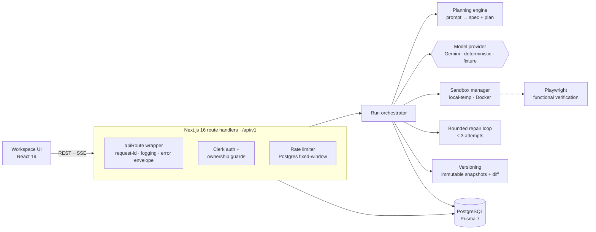
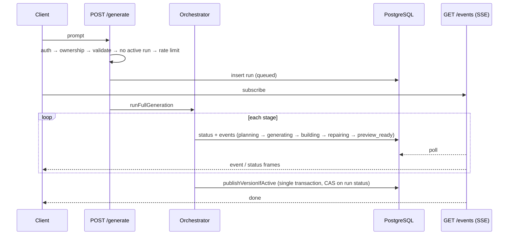

# Shipshape

[](https://github.com/vbhvx/Shipshape/actions/workflows/ci.yml)

**An AI application builder.** Describe an app in plain English. Shipshape plans it, generates a multi-file Next.js codebase, validates and repairs it in a sandbox, and publishes an immutable, diffable version you can preview, modify by chat, roll back, or export.

The interesting part is not the UI. It's the backend that makes an unreliable process (LLM code generation) behave predictably: durable run state, cooperative cancellation across instances, transactional publishing, bounded self-repair, and tenant isolation on every query.

---

## Architecture



### Life of a generation run



## Engineering highlights

| Concern | How it's handled | Where |
|---|---|---|
| **Race-free publishing** | A version is published in one transaction that flips the run to `completed` only `WHERE status NOT IN (terminal)`. If a cancel wins the race, 0 rows update and nothing is published. | `src/lib/db/prisma-adapter.ts` → `publishVersionIfActive` |
| **Cross-instance cancellation** | Cancels are written to the database. The executing instance polls the run row and aborts in-flight model calls through an `AbortController`. | `src/server/jobs/orchestrator.ts` |
| **Crash recovery** | Any reader that finds an active run older than the stale threshold (deliberately longer than `maxDuration`) reaps it as `RUN_TIMEOUT`, so a dead instance can't wedge a project. | `src/server/jobs/run-lifecycle.ts` |
| **Distributed rate limiting** | Per-user fixed windows stored in Postgres with a single atomic `INSERT … ON CONFLICT DO UPDATE … RETURNING`. Fails open on store outage. Tested under concurrent burst against real Postgres in a non-UTC zone. | `src/lib/http/rate-limit.ts` |
| **Tenant isolation** | Every route resolves resources through ownership guards. Missing and foreign resources both return the same 404, so IDs can't be enumerated. Version references are checked to belong to the project. | `src/lib/auth/session.ts` |
| **Uniform API contract** | One wrapper owns request IDs, structured access logs, and error mapping (`ApiError`, Zod, auth). Handlers contain only business logic. | `src/lib/http/handler.ts` |
| **Bounded self-repair** | Failed build checks feed a repair loop capped at 3 attempts, with every attempt logged as run events. | `src/modules/repair/repair-loop.ts` |
| **Sandboxed execution** | Pluggable `SandboxProvider`. The Docker provider drops capabilities, caps memory/CPU/PIDs, runs as non-root, and binds only to localhost. | `src/modules/sandbox/` |
| **Path safety** | Generated file paths are normalized and rejected on traversal, absolute paths, null bytes, and sensitive names. Credential-shaped strings are scrubbed from exported archives, and structured logs redact sensitive keys. | `src/server/security/safe-paths.ts` |
| **Operability** | Liveness `/api/health`, readiness `/api/ready` (DB check with timeout), JSON logs with secret redaction, fail-fast env validation that exits a misconfigured instance. | `src/app/api/health`, `src/instrumentation*.ts` |

Design rationale and trade-offs are in [`docs/ARCHITECTURE.md`](docs/ARCHITECTURE.md).

## Tech stack

Next.js 16 (App Router, Cache Components) · React 19 · TypeScript · Prisma 7 + PostgreSQL (Neon) · Clerk · Zod 4 · Tailwind CSS 4 · Vitest · Playwright · Docker · GitHub Actions

## Getting started

Requires **Node.js 24**, PostgreSQL (or none, see below), and Clerk development keys.

```bash
npm install
cp .env.example .env.local      # set DATABASE_URL, DIRECT_URL, Clerk keys
npm run db:migrate              # prisma migrate deploy
npm run dev
```

Without `DATABASE_URL`, development falls back to a local JSON store (`.shipshape-data/`). Production refuses to start without a database. Without `GEMINI_API_KEY`, generation uses the deterministic engine, so no AI key is needed to run the full product locally.

**Production-like stack in one command:**

```bash
docker compose up --build       # Postgres → migrations job → app on :3000
```

## Quality gates

```bash
npm run lint        # ESLint
npm run typecheck   # tsc --noEmit
npm test            # Vitest: unit + integration (Docker/DB suites auto-skip when unavailable)
npm run build       # production build
```

CI ([`.github/workflows/ci.yml`](.github/workflows/ci.yml)) runs these jobs on every PR:

- lint, typecheck, unit tests, and a check that the generated Prisma client is up to date
- migrations applied to a fresh Postgres, plus a schema-drift check and DB integration tests
- the production build
- a Docker image build, which also checks that a misconfigured container exits and a configured one passes its health check

A weekly job ([`sandbox-e2e.yml`](.github/workflows/sandbox-e2e.yml)) runs the full Docker + Playwright vertical slice.

## Documentation

- [`docs/ARCHITECTURE.md`](docs/ARCHITECTURE.md): system design, data model, key decisions
- [`docs/OPERATIONS.md`](docs/OPERATIONS.md): deployment, configuration, probes, runbook
- [`docs/SECURITY.md`](docs/SECURITY.md): threat model, controls, known limitations
- [`docs/PROJECT_DOCUMENTATION.md`](docs/PROJECT_DOCUMENTATION.md): full API and data-model reference
- [`docs/reports/`](docs/reports): benchmark and evaluation reports (Gemini live runs, E2E, replay)

## Project layout

```
src/
  app/               routes only: pages, error boundaries, and thin /api/v1 handlers
  components/        workspace panels; ui/ for shared pieces (ErrorState)
  hooks/             client data hooks (useProjectList)
  lib/api/           browser client: the only place the UI calls fetch
  lib/http/          apiRoute wrapper, ApiError, rate limiter
  lib/auth/          Clerk session -> user provisioning, ownership guards
  lib/db/            storage facade: Prisma adapter (prod) / JSON adapter (local dev), one contract
  lib/runs/          run status rules shared by server and UI
  modules/           planning · ai providers · generation · sandbox · repair · verification · versioning · export
  server/jobs/       run orchestrator and lifecycle
public/landing/      static marketing page served at /
prisma/              schema + migrations
tests/               unit, integration, benchmark harness
```

Layer rules and the UI's data flow: [`docs/ARCHITECTURE.md`](docs/ARCHITECTURE.md#2a-layers-and-what-may-import-what).
